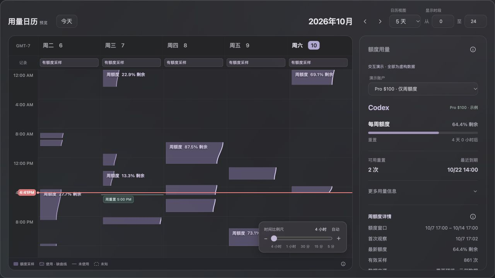

# Codex 用量日历

一个轻量、具有 macOS 风格的 Codex 额度日历。通过官方 Codex app-server 登录并查询额度，用逐渐变窄的区块表示剩余用量。

[English](README.md) · [示例预览](https://codex-usage-calendar-preview.vercel.app)



## 开始使用

需要 macOS、Python 3.9+，以及已安装到 PATH 的[官方 Codex CLI](https://github.com/openai/codex)。账号接口已在 CLI 0.144.5 上检查，后续版本可能有兼容性变化。

```sh
git clone https://github.com/tianxiangcai98-maker/codex_usage_calendar.git
cd codex_usage_calendar
python3 server.py
```

打开 **http://localhost:8765**，点击 **连接 ChatGPT**，在官方登录页面完成认证。macOS 也可以双击 `Start Usage Calendar.command`。

应用每 5 分钟刷新一次，打开或重新访问页面也会请求更新。数据仅保存在项目的 `data/` 中，登录会话与平时使用的 Codex 分开；不会读取 Codex 对话日志。

## 日历怎么看

- 区块宽度表示剩余额度；未观察到消耗或缺少连续采样时留出 Gap。
- 支持日、5 天、周、月、季度、年视图。
- 右下角比例尺可在 4 小时、1 小时、30 分钟、15 分钟和 5 分钟之间连续缩放。
- 根据 API 返回的额度窗口显示右侧信息，只有周额度时隐藏短窗口。
- 历史使用日期以斜纹标记；有真实采样才显示额度曲线。未知记录不会当成“没有使用”。
- 重置提醒需要点击授权，并保持页面打开；后台冻结或关闭页面可能导致提醒延迟或失效。

## 本机版与预览

本机版通过你自己的登录查询真实额度。线上预览全部使用虚构数据，没有登录和后台采样能力。这个开源版本是本地浏览器应用，还不是签名、公证后的原生 Mac App。

官方个人账号接口暂未提供历史日内额度曲线，因此不能准确补画启动采样前的曲线。额度比例存在取整，Gap 也不能证明当时没有运行任务。

## 文档与开发

完整文档见 [README 文档目录](README.md#documentation)。包含安装、使用、架构、数据模型、隐私、安全、开发、部署和贡献说明。

```sh
python3 scripts/check.py
python3 build-preview.py
python3 scripts/audit_public.py
```

公开部署只能上传 `preview/`。不要上传 `data/`、登录缓存、私人截图或本地部署配置。应用源码采用 [MIT 许可](LICENSE)，这是独立社区项目，并非 OpenAI 官方产品。
