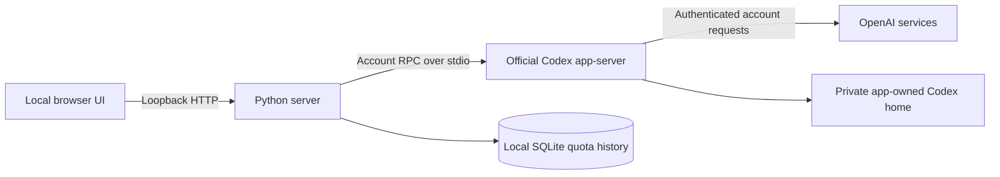

# Architecture

## Components

- `server.py`: loopback HTTP endpoints, account-scoped persistence, five-minute polling, and response sanitization.
- `codex_bridge.py`: launches the installed official runtime, initializes its protocol, correlates request IDs, and receives login notifications. It starts no model turns or task-execution requests.
- `index.html`: calendar and sidebar rendering, zoom, navigation, sign-in dialogs, and reminder UI.
- `quota-model.js`: classifies windows by duration instead of assuming API slot names or prices.
- `usage-shape.js`: measured curve geometry and activity segmentation.
- `usage-estimates.js`: recent-rate and equivalent-window calculations.
- `overview.js`, `history-ui.js`, `history.css`: date-level evidence and historical views.
- `motion.js`, `motion.css`: native-dialog state and application-owned transitions.
- `build-preview.py`, `preview/preview-data.js`: standalone synthetic interface build.

## Account flow

The bridge sets `CODEX_HOME` to this app's private runtime directory and removes inherited API-key/base-URL overrides from its child environment. It calls `initialize`, then `account/login/start` with the ChatGPT account type. The browser receives the official authorization URL; the runtime reports completion. Cancellation and logout use the corresponding managed account methods.

Collection calls `account/read`, `account/rateLimits/read`, and `account/usage/read`. Only quota fields, plan type, reset availability, and daily activity states enter app storage. Account email is used transiently to derive the storage key; it is not sent to the UI.

## Local HTTP API

| Route | Method | Purpose |
|---|---|---|
| `/api/usage` | GET | Sanitized account state, quota samples, daily activity |
| `/api/refresh` | POST | Request a refresh, coalesced for ten seconds |
| `/api/auth/login` | POST | Start managed login |
| `/api/auth/cancel` | POST | Cancel pending login |
| `/api/auth/logout` | POST | Sign out this application's runtime |

POST requests require a matching loopback Origin and Host. The server rejects cross-site fetches, serves an explicit static-file allowlist, and does not expose the private data directory. See [security](../SECURITY.md) for boundaries.

## Collection lifecycle

The server collects on startup and every 300 seconds while running. Page visits and visibility changes request an additional update. The browser reads local cached state every five seconds; this is not a five-second cloud poll. A lock prevents parallel collection and collection during a pending login. Errors preserve previously saved observations and surface a stale state.

This process is not a cloud service, launch agent, or packaged native app. Runtime and browser suspension behavior are documented in [limitations](limitations.md).

Protocol reference: [official Codex app-server documentation](https://learn.chatgpt.com/docs/app-server).
